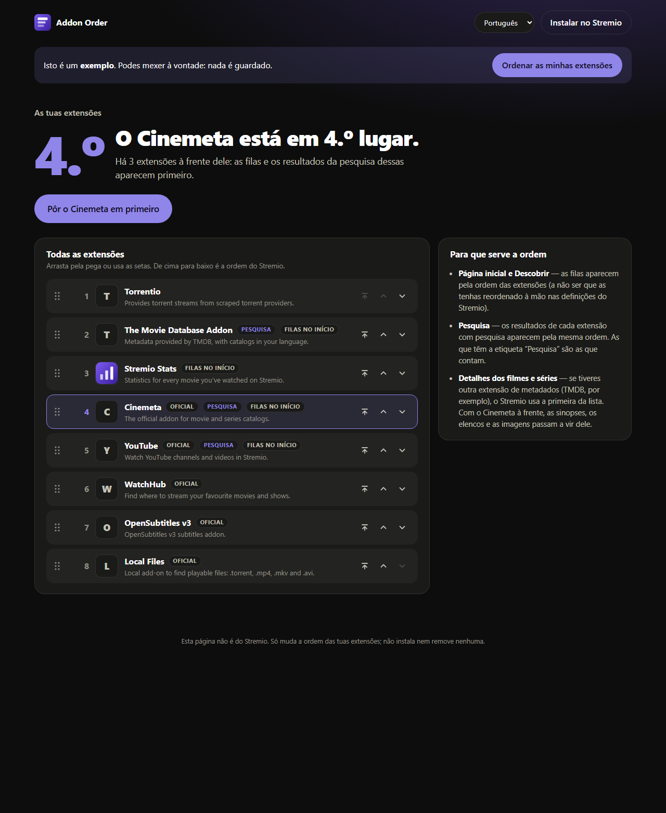

# Addon Order

**Put Cinemeta first in Stremio, on the home screen and in search. You can also drag your add-ons into any order.**

👉 **[megacosmos.github.io/stremio-addon-order](https://megacosmos.github.io/stremio-addon-order/)** · [see the example](https://megacosmos.github.io/stremio-addon-order/?exemplo&lang=en)



Stremio uses the order of your add-ons for almost everything. It sets the order of the rows on the home screen and in
Discover, the order of the results in search, and which add-on provides the details of each movie or series. But
Stremio has no way to change that order. Install a few add-ons and Cinemeta, the official catalogue, ends up at the
bottom of everything.

Addon Order fixes that:

- **One click:** *Put Cinemeta first*.
- **Or by hand:** drag any add-on by its handle, or use the arrows. "Move to top" is one tap, and the keyboard
  works too (↑ ↓ and Home on the handle).
- **Tags** show which add-ons have **search** (only these affect the search order) and which add **rows to the
  home screen**.
- **Restore the previous order** after saving, in case you change your mind.

Once you've saved, close and reopen Stremio on each device to see the new order.

## How to use it

1. Go to **[megacosmos.github.io/stremio-addon-order](https://megacosmos.github.io/stremio-addon-order/)**.
2. Click **Sign in with my Stremio account**. A 4-letter code appears, which you confirm on Stremio's official
   page. This is the same system Stremio uses to connect a TV. You can also sign in with email and password.
3. Click **Put Cinemeta first**, or reorder the list and click **Save to Stremio**.

**Inside Stremio:** click **Install in Stremio** to add Addon Order as an add-on. It doesn't add any rows or
catalogues. It just puts this page behind the add-on's **Configure** button. You can also install it straight from
the manifest:
`https://megacosmos.github.io/stremio-addon-order/manifest.json`

## Safe by design

- **It only changes the order.** It never installs, removes or edits an add-on.
- Right before saving, it reads your add-on list again. If anything was installed or removed in the meantime (on
  another device, for example), it **doesn't save**. It reloads the list and asks you to check it.
- After saving, it reads the list once more to confirm that Stremio kept exactly that order.

## Privacy

- **Your password never goes through Addon Order.** With the 4-letter code you don't even type it. With email and
  password, it goes straight from your browser to Stremio.
- There's no server. It's a static page on GitHub Pages, and every request goes from your browser directly to
  `api.strem.io`.
- The page keeps the session key Stremio gives it only in your browser. **Sign out** deletes it.

## For developers

Plain HTML, CSS and JavaScript, with no frameworks and no dependencies. It has the same look as
[Stremio Stats](https://github.com/MEGACOSMOS/stremio-stats). The code and its comments are in Portuguese.

| File | What it does |
|---|---|
| `index.html`, `ordem.js`, `estilo.css` | The page: sign-in, the list, dragging, saving |
| `colecao.js` | Order logic: Cinemeta first, moving, checking that the add-ons are still the same before saving |
| `textos.js` | Every piece of text, in Portuguese and English |
| `demo.js` | The example add-on list |
| `manifest.json` | The Stremio add-on (no catalogues, just `configurable`) |
| `configure/` | Where Stremio's **Configure** button lands; it forwards to the page |

```bash
npm run dev    # http://localhost:8020 (the example is at /?exemplo)
npm test       # checks the order logic and that both languages have every text
```

Under the hood it uses Stremio's own API: `addonCollectionGet` to read the list and `addonCollectionSet` to save
it in the new order.

---

*Independent project, not affiliated with Stremio. "Stremio" is a trademark of its owners.*
